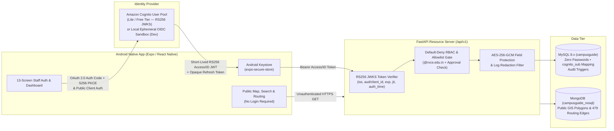

# Authentication Architecture — RVCE Campus Navigator

## 1. Executive Summary

RVCE Campus Navigator enforces a strict two-tier access model separating **unauthenticated public campus navigation (`PUBLIC`)** from the **verified institutional Faculty & Staff Portal (`FACULTY`, `STAFF`, `ADMIN`)**:

- **Public Users (`PUBLIC`)**: Access the interactive MapLibre campus map, 28 building footprints, 339+ public faculty cabin listings, floor schematics, 12 campus amenities, and 479-segment Dijkstra `From (A) -> To (B)` turn-by-turn routing **with zero sign-in prompts, zero account creation, and zero personal telemetry**.
- **Authorised RVCE Faculty & Staff**: Authenticate via **Amazon Cognito User Pools** (Lite / Free Tier) using **OpenID Connect (OIDC)** and **OAuth 2.0 Authorization Code Flow with `S256` PKCE** (`rvce-navigator://auth/callback`) on a **public native Android client** (`edu.rvce.campusguide`) with **zero embedded client secrets or AWS IAM credentials**.

---

## 2. System Topology

---

## 3. Core Architectural Invariants

1. **Zero Password Storage in Application Databases**:
   - The `users` table in MySQL (`database/mysql/01_schema.sql`) contains **zero** `password`, `password_hash`, `mfa_secret`, `access_token`, or `refresh_token` columns.
   - All credential verification, SRP/password hashing, email OTP verification, and RFC-6238 TOTP MFA secrets are delegated exclusively to Amazon Cognito.
2. **Asymmetric `RS256` Token Verification**:
   - `backend/app/auth/cognito_verifier.py` fetches the User Pool's public JSON Web Key Set (`/.well-known/jwks.json`) via `PyJWKClient` and verifies `alg == "RS256"`, `iss`, `client_id`/`aud`, `token_use`, `exp`, `iat`, and `sub`.
   - Symmetric algorithms (`HS256`, `none`) are unconditionally rejected (`401 Unauthorized`).
3. **Public Native Client with `S256` PKCE**:
   - Mobile clients cannot keep secrets confidential against APK reverse engineering (OWASP MASVS-AUTH / RFC 8252).
   - The Android client (`mobile/src/services/cognitoAuth.ts`) generates 256-bit cryptographic `code_verifier` values via `expo-crypto` and transmits `code_challenge_method=S256` to `/oauth2/authorize`, exchanging authorization codes at `/oauth2/token` without a client secret.
4. **Hardware-Backed Token Persistence**:
   - Short-lived `RS256` access/ID tokens (15-minute TTL) and refresh tokens are stored inside Android Keystore encrypted storage (`expo-secure-store` with `WHEN_UNLOCKED_THIS_DEVICE_ONLY`), excluded from Android cloud/ADB backups (`android:allowBackup="false"`).
5. **Two-Layer Institutional Eligibility**:
   - Cognito email verification proves ownership of an `@rvce.edu.in` mailbox, **not** institutional staff authority.
   - `POST /api/v1/auth/complete-registration` checks `staff_eligibility_allowlist`; non-allowlisted `@rvce.edu.in` holders are placed in `PENDING_APPROVAL` (`is_active = FALSE`, zero RBAC roles) until an `ADMIN` explicitly approves them.
6. **Multi-Layer Session Revocation**:
   - Single-device logout (`POST /api/v1/auth/logout`) records the SHA-256 digest of the token `jti` (`revoked_token_jtis`) and revokes the Cognito refresh token.
   - Global sign-out (`POST /api/v1/auth/logout-all`) advances `users.tokens_valid_after` (compared via UTC epoch `UNIX_TIMESTAMP`) and invokes Cognito `GlobalSignOut`, immediately invalidating all previously minted tokens across all devices.

---

## 4. Development vs Production Provider Modes

| Capability | Production (`AWS_COGNITO`) | Local Dev/Test (`DEV_OIDC_SANDBOX`) |
| :--- | :--- | :--- |
| Signing Algorithm | Asymmetric `RS256` (Cognito Managed JWKS) | Asymmetric `RS256` (Ephemeral 2048-bit RSA in RAM) |
| Password Persistence | Managed inside AWS Cognito User Pool | Ephemeral process RAM only (wiped on restart; zero DB storage) |
| OAuth 2.0 + `S256` PKCE | `https://<domain>.auth.<region>.amazoncognito.com/oauth2/*` | `/api/v1/dev-oidc/oauth2/*` |
| MFA Factor | TOTP Authenticator (`AssociateSoftwareToken`) | RFC-6238 TOTP Authenticator (`associate-totp`) |
| Production Guardrail | Required when `APP_ENV=production` | Hard-disabled when `APP_ENV=production` (`validate_security_posture()`) |
