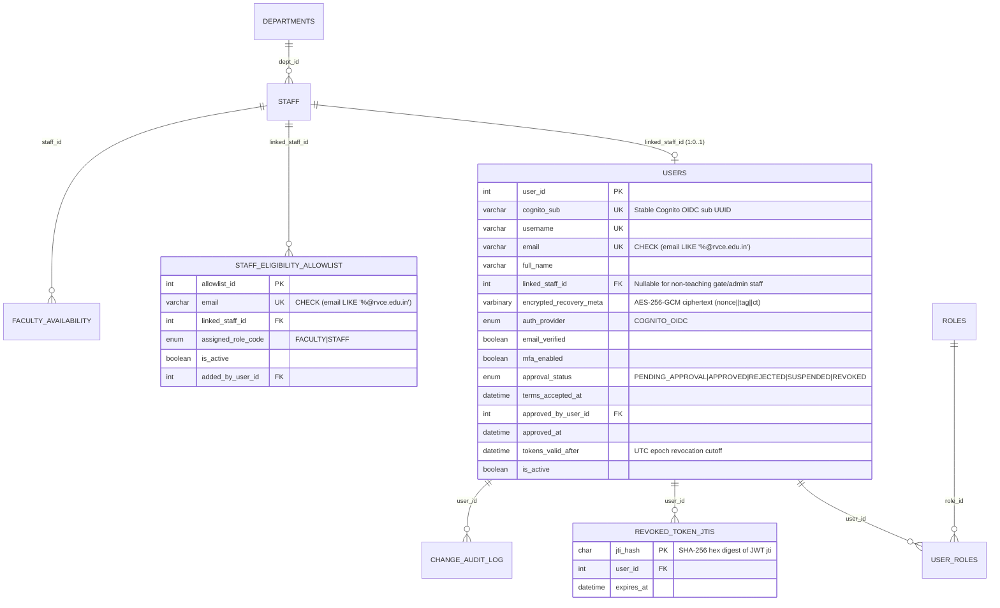

# Database Identity Mapping & Data Protection

## 1. Zero-Secret Relational Schema (`campusguide`)

The existing MySQL schema (`database/mysql/01_schema.sql`) reuses the institutional `departments`, `staff`, `faculty_availability`, `roles`, `user_roles`, and `change_audit_log` tables without duplicating faculty records.

### Prohibited Data Never Stored in MySQL or MongoDB
Verified automatically by `test_zero_password_database_and_aesgcm_roundtrip` against `information_schema.columns`:
- **No** plaintext passwords or password hashes (`password_hash` column completely removed).
- **No** raw OAuth access tokens, ID tokens, or refresh tokens.
- **No** TOTP MFA shared secrets (`AssociateSoftwareToken` secrets live only inside Cognito).
- **No** plaintext recovery codes.

---

## 2. Entity-Relationship Identity Mapping

---

## 3. Cryptographic Protection & Honest Key-Management Disclosure

- **Authenticated Field Encryption (`AES-256-GCM`)**:
  - Sensitive internal metadata (`users.encrypted_recovery_meta`) is encrypted using 256-bit `AESGCM` (`cryptography.hazmat.primitives.ciphers.aead.AESGCM`) with a fresh 96-bit CSPRNG nonce per write and authenticated additional data (`AAD = "users.encrypted_recovery_meta"`).
  - Key material is injected via environment/KMS secret `DATA_PROTECTION_KEY_B64` (never committed to source control; `validate_security_posture()` blocks startup in `production` if missing).
- **Explicit Non-Zero-Knowledge Disclosure**:
  - This architecture provides **application-layer authenticated encryption at rest**, **not** end-to-end / zero-knowledge encryption, because the authorised backend service holds `DATA_PROTECTION_KEY_B64` to encrypt and decrypt protected fields when needed.
- **Public Directory Privacy Boundary**:
  - Public endpoints (`GET /api/v1/faculty`, `GET /api/v1/rooms/{id}`, `GET /api/v1/search`) filter on `s.status = 'ACTIVE' AND s.profile_visibility = 'PUBLIC'` (`vw_public_faculty_directory`) and expose only institutional office metadata (`display_name`, `designation`, `dept_name`, `office_room_number`, `public_email`, `effective_availability`). Internal `cognito_sub`, personal onboarding notes, and `INTERNAL_ONLY`/`HIDDEN` staff profiles are never returned to public callers.

---

## 4. Least-Privilege Database Principal (`06_least_privilege_db_user.sql`)

Production runtime connections use the restricted MySQL principal `campusguide_app` rather than `root`:
- Granted only `SELECT, INSERT, UPDATE, DELETE, EXECUTE` on `campusguide.*`.
- **No** `DROP`, `ALTER`, `TRUNCATE`, `CREATE USER`, `SUPER`, or `FILE` privileges.
- `DELETE` on `campusguide.change_audit_log` is explicitly revoked so runtime application compromise cannot erase historical audit records.
