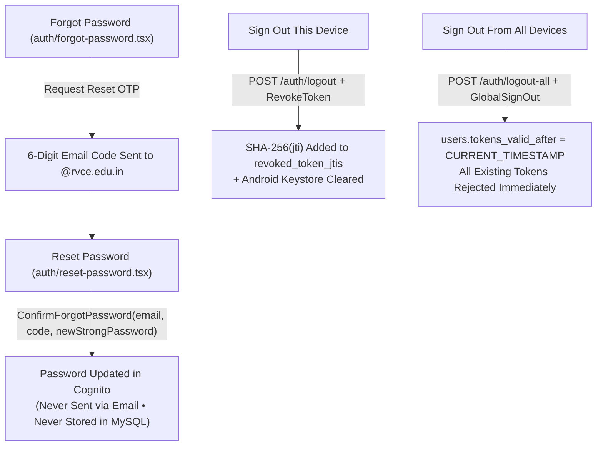

# Login, MFA & Account Recovery Flow

## 1. Sign-In Experience (`mobile/app/auth/sign-in.tsx`)

RVCE Campus Navigator supports two Cognito-backed authentication entrypoints for `@rvce.edu.in` staff:

1. **Native Cognito Password + TOTP Challenge Flow**:
   - Collects normalised `@rvce.edu.in` email and password (with show/hide toggle and client-side rapid-tap debounce).
   - Authenticates over TLS against Cognito `InitiateAuth` (`USER_PASSWORD_AUTH`).
   - Handles step-up challenges deterministically:
     - `UserNotConfirmedException` / `EMAIL_NOT_VERIFIED` -> routes to `auth/verify-email.tsx`.
     - `SOFTWARE_TOKEN_MFA` -> routes to `auth/mfa-challenge.tsx` for 6-digit RFC-6238 Authenticator verification.
     - Verified session -> evaluates backend onboarding status (`APPROVED` -> `auth/transition.tsx` -> Dashboard; `PENDING_APPROVAL` -> `auth/pending-approval.tsx`; `REJECTED`/`SUSPENDED`/`REVOKED` -> `auth/rejected.tsx`).
2. **Standards-Based OAuth 2.0 Authorization Code Flow with `S256` PKCE**:
   - Invokes `cognitoClient.signInWithOidcPkce()` using `expo-crypto` SHA-256 PKCE challenge and `expo-web-browser` Custom Tabs (`rvce-navigator://auth/callback`).
   - Validates cryptographic `state` parameter on callback before exchanging `code` + `code_verifier` at `/oauth2/token`.
   - Automatically supports Cognito Managed Login Passkeys (WebAuthn) when enabled on the User Pool.

---

## 2. Anti-Enumeration & Rate-Limiting Protections

- **Uniform Login Failure Messaging**: Whether an `@rvce.edu.in` address is unregistered or the password is wrong, both backend and `sanitizeAuthErrorMessage(err, 'LOGIN')` return the exact generic message:
  > `"Invalid institutional email or password."`
- **Uniform Password-Reset Messaging**: `POST` forgot-password always displays the same confirmation message regardless of whether the `@rvce.edu.in` email has an active Cognito account, preventing account enumeration.
- **Brute-Force Rate Limiting**: Sliding-window per-IP + per-account rate limiting throttles repeated sign-in, OTP verification, and password-reset attempts (`429 Too Many Requests`), complemented by client-side cooldown timers.
- **Sensitive Log Redaction**: `SensitiveLogRedactor` (`backend/app/auth/data_protection.py`) scrubs `Authorization: Bearer ...`, `password`, `refresh_token`, `id_token`, `access_token`, `otp`, and `secret_code` patterns before any log handler emits output.

---

## 3. TOTP Multi-Factor Authentication (`staff/security.tsx` & `auth/mfa-challenge.tsx`)

- **Enrolment**:
  1. Authenticated staff open **Account Security (`staff/security.tsx`)** and tap **Set Up Authenticator App (TOTP)**.
  2. Client calls Cognito `AssociateSoftwareToken`, displaying the Base32 secret key and `otpauth://totp/...` URI compatible with Google Authenticator, Microsoft Authenticator, Authy, or FreeOTP (zero SMS charges).
  3. Staff enter a 6-digit code; client calls `VerifySoftwareToken` + `SetUserMFAPreference(Enabled=true)` and notifies `POST /api/v1/auth/mfa-sync` to update `users.mfa_enabled = TRUE`.
- **MFA Recovery**:
  - If a staff member loses their authenticator device, they cannot bypass MFA via weak security questions. Recovery requires institutional identity verification by an RVCE `ADMIN` resetting MFA in the AWS Cognito console under dual-control audit procedures.

---

## 4. Password Reset & Session Revocation

- **Step-Up Reauthentication for Sensitive Changes**: `PATCH /api/v1/auth/profile` inspects the signed `auth_time` / `iat` claim (`require_recent_reauthentication`, 15-minute window) so stale sessions must reauthenticate before altering public contact metadata.
